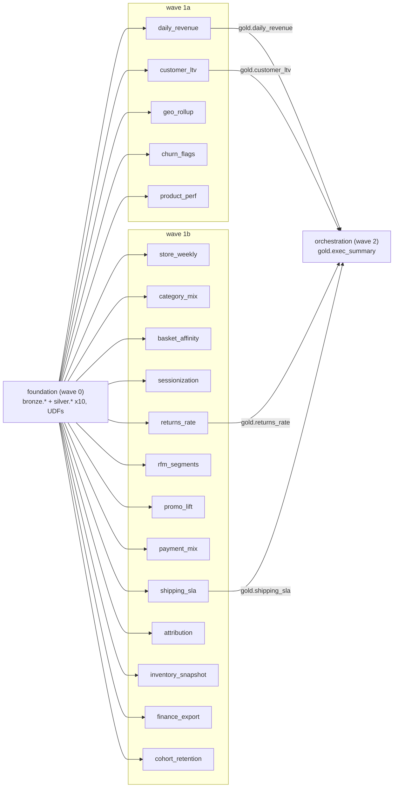

# DAIWT-03 Wave 0 discovery: legacy inventory and dependency graph

Source estate: `Cognition-Partner-Workshops-mirror/daiwt-03-redshift` @ `1bee48a` (paths below are relative to that repo).
Target contract: `Cognition-Partner-Workshops-mirror/daiwt-03-lakehouse-migration` `main` @ `80095cd` (`src/parity/contract.json`).
The current machine-readable plan is regenerated at `docs/units.yml` during discovery.

## 1. Estate layout

| area | path | contents |
| --- | --- | --- |
| foundation | `legacy/redshift/00_foundation/01_schemas.sql:3-4` | `CREATE SCHEMA core`, `mart` |
| foundation | `legacy/redshift/00_foundation/02_core_tables.sql:2-107` | 10 `core.*` tables (Redshift DDL: DISTKEY/SORTKEY/DISTSTYLE ALL/ENCODE lzo, CHAR(4), SUPER) |
| foundation | `legacy/redshift/00_foundation/03_udfs.sql:4-17` | 2 SQL UDFs |
| units | `legacy/redshift/units/<unit>/etl.sql`, `report.sql` | 18 units (wave 1a: 5, wave 1b: 13); `finance_export/export.sql` additionally |
| orchestration | `legacy/redshift/99_orchestration/exec_summary/{etl,report}.sql`, `refresh_schedule.yaml` | exec summary mart + nightly scheduler spec |
| unit list | `.migration/units.yaml:1-329` | waves (`:2-7`), per-unit `reads`/`writes`/`outputs`/`keys`/`capture_skip` |
| seeds | `data/seed/csv/*.csv`, `data/seed/generate_seed.py` | 10 seed CSVs (null marker `\N`) |
| goldens | `golden/<unit>/*.csv` + `*.meta.json`, `golden/PROVENANCE.json` | 48 D0 output goldens |
| validation | `validation/compare.py`, `validation/tolerances.yaml:5-10` | default tolerance `decimal_abs 0.000001`, `float_rel/abs 1e-9`, `string_rstrip: false` (CHAR padding is significant); `overrides: {}` |

Unit/wave registry (`.migration/units.yaml:2-7`): wave 0 `foundation`; 1a `daily_revenue, customer_ltv, geo_rollup, churn_flags, product_perf`; 1b `store_weekly, category_mix, basket_affinity, sessionization, shipping_sla, rfm_segments, promo_lift, payment_mix, returns_rate, attribution, inventory_snapshot, finance_export, cohort_retention`; 2 `orchestration`.

Naming map: legacy `core.<t>` -> target `bronze.<t>` (raw) + `silver.<t>` (golden-compared); legacy `mart.<t>` -> `gold.<t>`; each `report.sql` result -> `gold.report_<unit>` (`src/parity/contract.json`; legacy has no physical report tables, reports are SELECTs over marts). The logical silver/gold names are mapped back to `core`/`mart` by the capture operator (`.migration/00_context.md:12-15`).

## 2. Legacy objects

### 2.1 Tables: `core` (foundation, 10)

| table | DDL | distribution / sort | notable types | seed rows | target |
| --- | --- | --- | --- | --- | --- |
| core.customers | `02_core_tables.sql:2-14` | DISTKEY/SORTKEY customer_id | `region CHAR(4)` (:8), BIGINT id | 1,500 | silver.customers |
| core.stores | `:16-24` | DISTSTYLE ALL, SORTKEY store_id | `region CHAR(4)` (:18) | 40 | silver.stores |
| core.products | `:26-37` | DISTSTYLE ALL | NUMERIC(12,2) price/cost | 300 | silver.products |
| core.orders | `:39-48` | DISTKEY customer_id, SORTKEY order_ts | TIMESTAMP order_ts | 20,000 | silver.orders |
| core.order_items | `:50-59` | DISTKEY/SORTKEY order_id | NUMERIC(12,2) unit_price/discount, INT quantity | 40,938 | silver.order_items |
| core.payments | `:61-69` | DISTKEY order_id | NUMERIC(12,2) amount | 20,000 | silver.payments |
| core.returns | `:71-79` | DISTKEY order_item_id | INT quantity | 2,518 | silver.returns |
| core.shipments | `:81-89` | DISTKEY order_id | TIMESTAMP ship/delivered | 12,817 | silver.shipments |
| core.web_events | `:91-99` | DISTKEY customer_id | TIMESTAMP event_ts | 25,000 | silver.web_events |
| core.campaign_touches | `:101-107` | DISTKEY customer_id | `payload SUPER` (:104) | 8,000 | silver.campaign_touches |

Seed NULL profile (`\N` count): customers.phone 181; payments.method 2,826; returns.reason 461; shipments.delivered_ts 987; web_events.customer_id 3,707; all other columns 0. Seed time range: orders.order_ts 2025-01-01 00:28:48 .. 2025-12-31 23:38:01; 63 shipments have `ship_ts` on 2026-01-01 (after the 2025-12-31 anchor). `campaign_touches.payload.touches` holds 1-4 touch objects (`channel`, `campaign_id`, `ts`); 20,003 touch elements total.

### 2.2 Tables: `mart` (19, all DROP + CREATE per run)

| mart | built by | create style | target |
| --- | --- | --- | --- |
| mart.daily_revenue | `units/daily_revenue/etl.sql:2-14` | CTAS, DISTSTYLE ALL | gold.daily_revenue |
| mart.customer_ltv | `units/customer_ltv/etl.sql:4-19` | CTAS | gold.customer_ltv |
| mart.geo_rollup | `units/geo_rollup/etl.sql:3-18` | CTAS | gold.geo_rollup |
| mart.churn_flags | `units/churn_flags/etl.sql:3-11` + proc | DDL + proc INSERT | gold.churn_flags |
| mart.product_perf | `units/product_perf/etl.sql:2-43` | CTAS (CTEs) | gold.product_perf |
| mart.store_weekly | `units/store_weekly/etl.sql:2-17` | CTAS | gold.store_weekly |
| mart.category_mix | `units/category_mix/etl.sql:2-16` | CTAS | gold.category_mix |
| mart.basket_affinity | `units/basket_affinity/etl.sql:2-12` | CTAS | gold.basket_affinity |
| mart.web_sessions | `units/sessionization/etl.sql:2-42` | CTAS (CTEs) | gold.web_sessions |
| mart.shipping_sla | `units/shipping_sla/etl.sql:3-17` | CTAS | gold.shipping_sla |
| mart.rfm_segments | `units/rfm_segments/etl.sql:3-37` | CTAS (CTEs) | gold.rfm_segments |
| mart.promo_lift | `units/promo_lift/etl.sql:2-18` | CTAS (CTE) | gold.promo_lift |
| mart.payment_mix | `units/payment_mix/etl.sql:2-17` | CTAS | gold.payment_mix |
| mart.returns_rate | `units/returns_rate/etl.sql:3-15` | CTAS | gold.returns_rate |
| mart.attribution | `units/attribution/etl.sql:2-10` | CTAS (PartiQL) | gold.attribution |
| mart.inventory_snapshot | `units/inventory_snapshot/etl.sql:3-11` + proc | DDL + proc DELETE/INSERT | gold.inventory_snapshot |
| mart.finance_monthly | `units/finance_export/etl.sql:3-16` | CTAS | gold.finance_monthly |
| mart.cohort_retention | `units/cohort_retention/etl.sql:2-9` + temp steps | DDL + INSERT SELECT | gold.cohort_retention |
| mart.exec_summary | `99_orchestration/exec_summary/etl.sql:3-18` | CTAS | gold.exec_summary |

### 2.3 Stored procedures (plpgsql)

| proc | path | behaviour | invoked |
| --- | --- | --- | --- |
| sp_build_churn_flags() | `units/churn_flags/etl.sql:13-51` | temp `tmp_last_orders` (:18-28), row-by-row FOR loop INSERT into mart.churn_flags (:30-47) | `CALL` at :53 |
| sp_upsert_inventory(p_snapshot DATE) | `units/inventory_snapshot/etl.sql:13-39` | temp `stg_inventory` (:16-24), DELETE matching product_ids (:26-27), INSERT all products (:29-35) | `CALL sp_upsert_inventory('2025-12-31'::DATE)` at :41 |

### 2.4 UDFs (SQL, created without schema qualifier)

| udf | path | definition | used by |
| --- | --- | --- | --- |
| f_fiscal_qtr(DATE) -> VARCHAR(8) | `00_foundation/03_udfs.sql:4-9` | `'Q' \|\| ((((EXTRACT(MONTH)::INT + 9) % 12) / 3) + 1)` with integer division (:8). Resulting mapping: Mar-May=Q1, Jun-Aug=Q2, Sep-Nov=Q3, Dec-Feb=Q4 (golden `finance_export/finance_monthly.csv` confirms Jan/Feb/Dec = Q4). The target mirrors the expression at :8. | `units/finance_export/etl.sql:10` |
| f_clean_phone(VARCHAR) -> VARCHAR(32) | `03_udfs.sql:12-17` | `REGEXP_REPLACE($1, '[^0-9]', '')` (keeps a leading country-code `1`; seed yields 987 ten-digit and 332 eleven-digit results; NULL in -> NULL out) | `units/customer_ltv/etl.sql:11` |

### 2.5 Temp tables

| temp table | path | scope |
| --- | --- | --- |
| tmp_last_orders | `units/churn_flags/etl.sql:18-28`, dropped :49 | inside sp_build_churn_flags |
| stg_inventory | `units/inventory_snapshot/etl.sql:16-24`, dropped :37 | inside sp_upsert_inventory |
| tmp_cohorts | `units/cohort_retention/etl.sql:11-16`, dropped :39 | session script |
| tmp_activity | `units/cohort_retention/etl.sql:18-26`, dropped :40 | session script |

### 2.6 Exports / scheduler

| object | path | notes |
| --- | --- | --- |
| UNLOAD mart.finance_monthly | `units/finance_export/export.sql:3-8` | `TO 's3://<bucket>/...' IAM_ROLE '<role-arn>' PARALLEL OFF CSV HEADER`; placeholders; in `capture_skip` (`.migration/units.yaml` finance_export entry); no golden |
| nightly_mart_refresh | `99_orchestration/refresh_schedule.yaml:3-39` | cron `0 2 * * *` UTC (:4-5); steps load_core (:7-9) -> wave_1a (:10-17) and wave_1b (:18-33) in parallel -> exec_summary (:34-36, after 1a+1b) and finance_export UNLOAD (:37-39, after 1b). In `capture_skip`; `golden/skipped_branches.json` (migration repo) records that `load_core`'s `--ddl-only` flag is not accepted by the runner and the UNLOAD step is never executed at capture. |

### 2.7 Reports (`report.sql`, one per unit; read only the unit's own mart unless noted)

| unit | path | extra reads | shape |
| --- | --- | --- | --- |
| daily_revenue | `units/daily_revenue/report.sql:2-8` | - | month x channel |
| customer_ltv | `units/customer_ltv/report.sql:2-9` | - | per CHAR(4) region |
| geo_rollup | `units/geo_rollup/report.sql:2-4` | - | passthrough |
| churn_flags | `units/churn_flags/report.sql:2-7` | - | per flag, AVG(INT) |
| product_perf | `units/product_perf/report.sql:2-8` | - | per category |
| store_weekly | `units/store_weekly/report.sql:2-10` | core.stores (:8) | per store, DATEDIFF(week) span |
| category_mix | `units/category_mix/report.sql:2-4` | - | passthrough, ORDER BY revenue DESC |
| basket_affinity | `units/basket_affinity/report.sql:2-10` | core.products x2 (:7-8) | top 50 pairs (`LIMIT 50`) |
| sessionization | `units/sessionization/report.sql:2-8` | - | per customer |
| shipping_sla | `units/shipping_sla/report.sql:2-5` | - | passthrough (drops earliest_local_delivery_hour) |
| rfm_segments | `units/rfm_segments/report.sql:2-8` | - | per segment, AVG(BIGINT) |
| promo_lift | `units/promo_lift/report.sql:2-4` | - | passthrough |
| payment_mix | `units/payment_mix/report.sql:2-7` | - | per method_family |
| returns_rate | `units/returns_rate/report.sql:2-4` | - | passthrough |
| attribution | `units/attribution/report.sql:2-7` | - | per campaign, SUM over channels |
| inventory_snapshot | `units/inventory_snapshot/report.sql:2-5` | - | 50 lowest on_hand (`LIMIT 50`) |
| finance_export | `units/finance_export/report.sql:2-7` | - | per fiscal_year x fiscal_qtr |
| cohort_retention | `units/cohort_retention/report.sql:2-8` | - | `ROUND(100.0*active/size, 2)` |
| orchestration | `99_orchestration/exec_summary/report.sql:2-5` | - | passthrough |

## 3. Seeds and goldens (row counts exclude header)

### 3.1 Seeds (`data/seed/csv/`) and golden inputs

| seed | rows | golden input (volume `inputs/D0/core.<t>.csv`) |
| --- | --- | --- |
| campaign_touches | 8,000 | 8,000 (sha = seed) |
| customers | 1,500 | 1,500 (sha differs: export carries CHAR(4) padding, e.g. `NE  `) |
| order_items | 40,938 | 40,938 (sha = seed) |
| orders | 20,000 | 20,000 (sha = seed) |
| payments | 20,000 | 20,000 (sha = seed) |
| products | 300 | 300 (sha = seed) |
| returns | 2,518 | 2,518 (sha = seed) |
| shipments | 12,817 | 12,817 (sha = seed) |
| stores | 40 | 40 (sha differs: CHAR(4) padding) |
| web_events | 25,000 | 25,000 (sha = seed) |

Seed checksums are pinned in `golden/PROVENANCE.json` (`seed_csv_sha256`).

### 3.2 Output goldens -> target tables

All 48 outputs: legacy `golden/<unit>/<file>` sha256 == `src/parity/contract.json` sha256 == volume manifest `/Volumes/daiwt_03_mig_prod/landing/golden/manifest.json` (byte-identical to migration repo `golden/manifest.json`); contract keys == units.yaml keys for every output; every report maps to `gold.report_<unit>` (verified, including `gold.report_orchestration`). The manifest has 58 file entries = 48 outputs + 10 inputs.

| unit | golden | rows | keys | target |
| --- | --- | --- | --- | --- |
| foundation | foundation/customers.csv | 1500 | customer_id | silver.customers |
| foundation | foundation/stores.csv | 40 | store_id | silver.stores |
| foundation | foundation/products.csv | 300 | product_id | silver.products |
| foundation | foundation/orders.csv | 20000 | order_id | silver.orders |
| foundation | foundation/order_items.csv | 40938 | order_item_id | silver.order_items |
| foundation | foundation/payments.csv | 20000 | payment_id | silver.payments |
| foundation | foundation/returns.csv | 2518 | return_id | silver.returns |
| foundation | foundation/shipments.csv | 12817 | shipment_id | silver.shipments |
| foundation | foundation/web_events.csv | 25000 | event_id | silver.web_events |
| foundation | foundation/campaign_touches.csv | 8000 | touch_id | silver.campaign_touches |
| daily_revenue | daily_revenue/daily_revenue.csv | 1460 | order_date, sales_channel | gold.daily_revenue |
| daily_revenue | daily_revenue/report.csv | 48 | order_month, sales_channel | gold.report_daily_revenue |
| customer_ltv | customer_ltv/customer_ltv.csv | 1500 | customer_id | gold.customer_ltv |
| customer_ltv | customer_ltv/report.csv | 6 | region | gold.report_customer_ltv |
| geo_rollup | geo_rollup/geo_rollup.csv | 21 | grouping_id, region, state | gold.geo_rollup |
| geo_rollup | geo_rollup/report.csv | 21 | grouping_id, region, state | gold.report_geo_rollup |
| churn_flags | churn_flags/churn_flags.csv | 1500 | customer_id | gold.churn_flags |
| churn_flags | churn_flags/report.csv | 4 | churn_flag | gold.report_churn_flags |
| product_perf | product_perf/product_perf.csv | 300 | product_id | gold.product_perf |
| product_perf | product_perf/report.csv | 6 | category | gold.report_product_perf |
| store_weekly | store_weekly/store_weekly.csv | 2120 | store_id, week_start | gold.store_weekly |
| store_weekly | store_weekly/report.csv | 40 | store_id | gold.report_store_weekly |
| category_mix | category_mix/category_mix.csv | 6 | category | gold.category_mix |
| category_mix | category_mix/report.csv | 6 | category | gold.report_category_mix |
| basket_affinity | basket_affinity/basket_affinity.csv | 50 | product_id_a, product_id_b | gold.basket_affinity |
| basket_affinity | basket_affinity/report.csv | 50 | product_id_a, product_id_b | gold.report_basket_affinity |
| sessionization | sessionization/web_sessions.csv | 21280 | customer_id, session_id | gold.web_sessions |
| sessionization | sessionization/report.csv | 1500 | customer_id | gold.report_sessionization |
| shipping_sla | shipping_sla/shipping_sla.csv | 4 | carrier | gold.shipping_sla |
| shipping_sla | shipping_sla/report.csv | 4 | carrier | gold.report_shipping_sla |
| rfm_segments | rfm_segments/rfm_segments.csv | 1500 | customer_id | gold.rfm_segments |
| rfm_segments | rfm_segments/report.csv | 103 | rfm_segment | gold.report_rfm_segments |
| promo_lift | promo_lift/promo_lift.csv | 4 | sales_channel | gold.promo_lift |
| promo_lift | promo_lift/report.csv | 4 | sales_channel | gold.report_promo_lift |
| payment_mix | payment_mix/payment_mix.csv | 5 | method | gold.payment_mix |
| payment_mix | payment_mix/report.csv | 4 | method_family | gold.report_payment_mix |
| returns_rate | returns_rate/returns_rate.csv | 6 | category | gold.returns_rate |
| returns_rate | returns_rate/report.csv | 6 | category | gold.report_returns_rate |
| attribution | attribution/attribution.csv | 100 | campaign_id, touch_channel | gold.attribution |
| attribution | attribution/report.csv | 20 | campaign_id | gold.report_attribution |
| inventory_snapshot | inventory_snapshot/inventory_snapshot.csv | 300 | product_id | gold.inventory_snapshot |
| inventory_snapshot | inventory_snapshot/report.csv | 50 | product_id | gold.report_inventory_snapshot |
| finance_export | finance_export/finance_monthly.csv | 12 | month | gold.finance_monthly |
| finance_export | finance_export/report.csv | 5 | fiscal_year, fiscal_qtr | gold.report_finance_export |
| cohort_retention | cohort_retention/cohort_retention.csv | 65 | cohort_month, month_offset | gold.cohort_retention |
| cohort_retention | cohort_retention/report.csv | 65 | cohort_month, month_offset | gold.report_cohort_retention |
| orchestration | orchestration/exec_summary.csv | 1 | snapshot_label | gold.exec_summary |
| orchestration | orchestration/report.csv | 1 | snapshot_label | gold.report_orchestration |

Golden CSV conventions (manifest `csv_conventions`): NULL `\N`, CHAR padding preserved, numerics as Redshift strings, SUPER via JSON_SERIALIZE, timestamps `YYYY-MM-DD HH:MM:SS[.ffffff]` UTC. No D1+ drops exist (`drops: ["D0"]`, full reload).

## 4. Dependency graph

### 4.1 Per-unit reads (verified against SQL) vs units.yaml `reads`

`core.X` is shown as its target `silver.X`; `mart.X` as `gold.X`.

| unit | etl reads (path:line) | report extra reads | UDF | units.yaml `reads` | agreement |
| --- | --- | --- | --- | --- | --- |
| daily_revenue | orders `etl.sql:11`, order_items `:12` | - | - | orders, order_items | match |
| customer_ltv | customers `:15`, orders `:16`, order_items `:17` | - | f_clean_phone `:11` | customers, orders, order_items | match (UDF dependency on foundation not listed) |
| geo_rollup | stores `:14`, orders `:15`, order_items `:16` | - | - | stores, orders, order_items | match |
| churn_flags | customers `:26`, orders `:27` | - | - | customers, orders | match |
| product_perf | order_items `:11,32`, orders `:12`, stores `:13`, products `:40` | - | - | products, order_items, orders, stores | match |
| store_weekly | orders `:14`, order_items `:15` | stores `report.sql:8` | - | orders, order_items, stores | match on union; stores is report-only |
| category_mix | order_items `:12`, products `:13` | - | - | products, order_items | match |
| basket_affinity | order_items `:7-8` (self-join) | products `report.sql:7-8` | - | order_items, products | match on union; products is report-only |
| sessionization | web_events `:21` | - | - | web_events | match |
| shipping_sla | shipments `:15` | - | - | shipments | match |
| rfm_segments | customers `:13`, orders `:14`, order_items `:15` | - | - | customers, orders, order_items | match |
| promo_lift | orders `:8`, order_items `:9` | - | - | orders, order_items | match |
| payment_mix | payments `:15` | - | - | payments | match |
| returns_rate | order_items `:11`, products `:12`, returns `:13` | - | - | order_items, products, returns | match |
| attribution | campaign_touches `:8` (+ `payload.touches` unnest) | - | - | campaign_touches | match |
| inventory_snapshot | order_items `:23`, products `:34` | - | - | products, order_items | match |
| finance_export | orders `:13`, order_items `:14` | export.sql reads mart.finance_monthly `:3` | f_fiscal_qtr `:10` | orders, order_items | match (UDF dependency on foundation not listed) |
| cohort_retention | orders `:15,23` | - | - | orders | match |
| orchestration | gold.daily_revenue `exec_summary/etl.sql:13`, gold.customer_ltv `:14`, gold.returns_rate `:16`, gold.shipping_sla `:18` | - | - | same four | match |

No wave 1a/1b unit reads another unit's mart; the only gold->gold reads are in `orchestration`. Every units.yaml `writes` entry matches the mart created by the SQL (note `sessionization` writes `gold.web_sessions`, `finance_export` writes `gold.finance_monthly`).

### 4.2 Unit-level `depends_on`

- `foundation`: none. Writes `bronze.*` and `silver.*` for all 10 core tables (units.yaml) and owns the two UDFs.
- All 18 wave 1a/1b units: `[foundation]` (silver reads; customer_ltv and finance_export also need the foundation UDFs).
- `orchestration`: `[daily_revenue, customer_ltv, returns_rate, shipping_sla]` (transitively foundation). The legacy scheduler gates exec_summary on all of wave_1a and wave_1b (`refresh_schedule.yaml:36`), a superset of the data dependency; `geo_rollup`, `churn_flags`, `product_perf` (1a) and 12 of the 13 1b units are not read by orchestration.

### 4.3 Mermaid

Silver-entity fan-out (how many units read each): order_items 12, orders 10, products 5, customers 3, stores 3, payments 1, returns 1, shipments 1, web_events 1, campaign_touches 1.

## 5. Per-unit semantics the target must mirror

| unit | legacy semantics (path:line) |
| --- | --- |
| daily_revenue | `TRUNC(order_ts)::DATE`, `COUNT(DISTINCT order_id)`, revenue `SUM(quantity*(unit_price-discount))` over INNER JOIN order_items; all order statuses included (`etl.sql:7-13`). Report `DATE_TRUNC('month')` (`report.sql:2`). |
| customer_ltv | LEFT JOINs from customers so customers with no orders get `order_count 0`, `ltv 0` (COALESCE), `aov` NULL; `aov = AVG(unit_price - discount)` per order line (`etl.sql:13-14`), NUMERIC(12,2) AVG result scale; `region` CHAR(4) padding retained (`:10`, golden `NE  `/`SW  `). Report AVG(ltv) per padded region (`report.sql:6`). |
| geo_rollup | `GROUPING SETS ((region),(state),())` with derived `grouping_id` 1/2/3 (`etl.sql:5-9,17`); LEFT JOIN from stores; NULL grouping columns rendered `\N`. |
| churn_flags | anchor `'2025-12-31'::DATE - last_order_date` (INT days); thresholds `>180 churned`, `>90 at_risk`, else `active`; NULL last order -> `never_ordered`, NULL days (`etl.sql:37-45`). Report AVG over INT truncates (golden 22/115/203). |
| product_perf | top-3 regions by units (ties by region) via ROW_NUMBER + `LISTAGG(region, ',') WITHIN GROUP (ORDER BY units DESC, region)` (`etl.sql:16-27`); output column is `top_stores` but contains region codes; LISTAGG output is unpadded; all 300 products via LEFT JOIN (`:40-42`). |
| store_weekly | `DATE_TRUNC('week')` (Monday), `week_end = +6 days`, `week_number = DATEDIFF(week, 2025-01-01, week_start)` (boundary count) (`etl.sql:8-11`). Report span `DATEDIFF(week,min,max)+1` (`report.sql:4`). |
| category_mix | `RATIO_TO_REPORT(revenue) OVER ()` -> float8 (`etl.sql:7`; golden e.g. `0.15411330152688182`). |
| basket_affinity | unordered pairs `b.product_id > a.product_id`, support `COUNT(DISTINCT order_id) >= 5` (`etl.sql:9-11`). Report LIMIT 50 ordered `pair_orders DESC, a, b` (`report.sql:9-10`). |
| sessionization | excludes NULL customer_id (`etl.sql:22`); new session when no previous event or `DATEDIFF(second, prev, ts) > 1800` (`:12-20`); session_id = running SUM ordered `event_ts, event_id` ROWS UNBOUNDED PRECEDING (`:29-31`). |
| shipping_sla | `DATEDIFF(hour, ship_ts, delivered_ts)` counts hour boundaries; `AVG(...)` of an integer expression then `::NUMERIC(10,2)` (`etl.sql:9`; golden values 71.00/72.00); `on_time_96h` counts `<= 96` (`:11-12`, NULL durations count 0); `MIN(EXTRACT(HOUR FROM CONVERT_TIMEZONE('UTC','America/Los_Angeles', delivered_ts)))` (`:13-14`). |
| rfm_segments | `recency_days = DATEDIFF(day, MAX(order_ts)::DATE, 2025-12-31)` (NULL for no orders) (`etl.sql:10`); `NTILE(5)` with Redshift default NULL ordering (NULLs last for ASC) (`:23-25`); segment = concatenation (`:35`). Report AVG(frequency) integer (`report.sql:5`). |
| promo_lift | order_total per order; `MEDIAN` and `PERCENTILE_CONT(0.9)` over NUMERIC (`etl.sql:14-15`). |
| payment_mix | group by raw `method` (NULL group -> `unknown`), DECODE families (`wallet`,`gift_card` -> DIGITAL; else OTHER), NVL2 status, `SUM/SUM(SUM()) OVER ()` NUMERIC share (golden 4 dp) (`etl.sql:4-16`). |
| returns_rate | `return_rate_int` = INT/INT integer division (`etl.sql:8`; golden all 0); `return_pct` NUMERIC(14,4)/NUMERIC(14,4)*100 (`:9-10`; golden 15 dp); returns LEFT JOINed at order_item grain (`:13`). |
| attribution | PartiQL unnest `FROM core.campaign_touches t, t.payload.touches tc` (`etl.sql:8`); SUPER `::VARCHAR(16)` casts; `COUNT(*)` touches and `COUNT(DISTINCT customer_id)` per campaign x channel. Report sums both per campaign (`report.sql:3-4`). |
| inventory_snapshot | `snapshot_date = p_snapshot ('2025-12-31')`, `on_hand = GREATEST(500 - units_sold, 0)::INT`, all products (`etl.sql:29-35,41`). Report LIMIT 50 by `on_hand ASC, product_id`. |
| finance_export | month = `DATE_TRUNC('month')`; `fiscal_year` = year if month >= 2 else year-1 (`etl.sql:6-9`); `fiscal_qtr` via f_fiscal_qtr (`:10`, mapping in 2.4). |
| cohort_retention | cohort = month of first order; `month_offset = DATEDIFF(month, cohort, order month)`; active = distinct buyers (`etl.sql:12-26`). Report `ROUND(100.0*active/size, 2)` (`report.sql:6`). |
| orchestration | single row `snapshot_label 'as_of_2025-12-31'`; `total_revenue/total_orders` = sums of daily_revenue; `avg_customer_ltv = AVG(ltv)` over all 1,500 customer_ltv rows; `overall_return_pct` = NUMERIC(14,4) ratio * 100; `avg_ship_hours = SUM(avg_hours_to_deliver*delivered)/SUM(delivered)` using the NUMERIC(10,2) mart values (`exec_summary/etl.sql:5-18`; golden 71.2551). |

## 6. Migration-repo state (main @ 80095cd)

- `src/sql/units/registry.json` is `{}` (`docs/registry.md:3`); registry entries need exactly `job`, `outputs`, `owns`, `depends_on` (`ci/registry.py:45-46`); outputs must be contract tables, non-output owned tables go in `owns` (`ci/registry.py:64-67`). Unit names must match units.yaml names.
- Suggested registry shape per unit: `outputs` = the unit's `target_tables` in `units.json` that appear in the contract (foundation: 10 `silver.*`; others: `gold.<mart>` + `gold.report_<unit>`); foundation `owns` = 10 `bronze.*`; `depends_on` as in 4.2.
- `databricks.yml` dev target: catalog `daiwt_03_mig_dev`, schemas `bronze_/silver_/gold_${schema_suffix}`; prod: `daiwt_03_mig_prod` with unsuffixed schemas; `golden_path /Volumes/daiwt_03_mig_prod/landing/golden`. No `resources/` directory exists on `main`.
