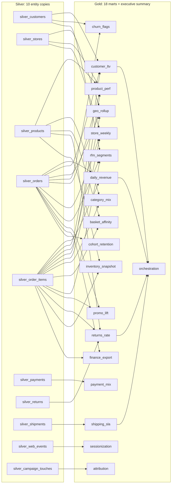

# DAIWT-03 legacy estate map

The Redshift retail estate maps to **29 migration units: 10 Silver and 19 Gold**. The 19 Gold units include 18 independent marts and the final executive summary. There are **48 captured outputs**: 29 table snapshots and 19 report result sets; 10 raw input files feed framework-managed Bronze landing. Only drop **D0** is captured (full reload).

Source: [`daiwt-03-redshift`](https://github.com/Cognition-Partner-Workshops-mirror/daiwt-03-redshift/tree/1bee48ad399b81b9764d5ac9a0e3f30fad0fd22a) at `1bee48ad399b81b9764d5ac9a0e3f30fad0fd22a`. The read-only live golden manifest matches `golden/manifest.json` exactly. The machine-readable plan is [units.yml](units.yml); legacy paths below refer to the source repository.

## Dependencies

The data DAG contains **42 unit-to-unit edges**, **10 roots**, and **three levels**: Silver entities → 18 Gold marts → executive summary. Each Gold unit also owns its report projection. Only daily_revenue, customer_ltv, returns_rate, and shipping_sla feed orchestration. Report-only source joins are included (stores for store_weekly; products for basket_affinity).

The source nightly specification is 02:00 UTC: load_core precedes both wave_1a (five marts) and wave_1b (13 marts); exec_summary waits for both complete waves. The finance UNLOAD branch follows wave_1b. Those scheduler barriers are broader than the data DAG above. The scheduler specification and external export were not captured or deployed.

## Legacy-to-target inventory

Reports are query result sets in the source, not extra source tables. Builders materialize each `gold.<unit>_report` alongside its base table so that every captured CSV has an exclusive target and can be checked independently. Golden paths are relative to `/Volumes/daiwt_03_mig_prod/landing/golden/`; keys and exact column order are in units.yml.

| Legacy job / source | Unit | Target tables | Golden files |
| --- | --- | --- | --- |
| foundation / core.customers (`legacy/redshift/00_foundation/02_core_tables.sql`) | `silver_customers` | `silver.customers` | `outputs/D0/foundation/customers.csv` |
| foundation / core.stores (`legacy/redshift/00_foundation/02_core_tables.sql`) | `silver_stores` | `silver.stores` | `outputs/D0/foundation/stores.csv` |
| foundation / core.products (`legacy/redshift/00_foundation/02_core_tables.sql`) | `silver_products` | `silver.products` | `outputs/D0/foundation/products.csv` |
| foundation / core.orders (`legacy/redshift/00_foundation/02_core_tables.sql`) | `silver_orders` | `silver.orders` | `outputs/D0/foundation/orders.csv` |
| foundation / core.order_items (`legacy/redshift/00_foundation/02_core_tables.sql`) | `silver_order_items` | `silver.order_items` | `outputs/D0/foundation/order_items.csv` |
| foundation / core.payments (`legacy/redshift/00_foundation/02_core_tables.sql`) | `silver_payments` | `silver.payments` | `outputs/D0/foundation/payments.csv` |
| foundation / core.returns (`legacy/redshift/00_foundation/02_core_tables.sql`) | `silver_returns` | `silver.returns` | `outputs/D0/foundation/returns.csv` |
| foundation / core.shipments (`legacy/redshift/00_foundation/02_core_tables.sql`) | `silver_shipments` | `silver.shipments` | `outputs/D0/foundation/shipments.csv` |
| foundation / core.web_events (`legacy/redshift/00_foundation/02_core_tables.sql`) | `silver_web_events` | `silver.web_events` | `outputs/D0/foundation/web_events.csv` |
| foundation / core.campaign_touches (`legacy/redshift/00_foundation/02_core_tables.sql`) | `silver_campaign_touches` | `silver.campaign_touches` | `outputs/D0/foundation/campaign_touches.csv` |
| daily_revenue (`legacy/redshift/units/daily_revenue/etl.sql`) | `daily_revenue` | `gold.daily_revenue` `gold.daily_revenue_report` | `outputs/D0/daily_revenue/daily_revenue.csv` `outputs/D0/daily_revenue/report.csv` |
| customer_ltv (`legacy/redshift/units/customer_ltv/etl.sql`) | `customer_ltv` | `gold.customer_ltv` `gold.customer_ltv_report` | `outputs/D0/customer_ltv/customer_ltv.csv` `outputs/D0/customer_ltv/report.csv` |
| geo_rollup (`legacy/redshift/units/geo_rollup/etl.sql`) | `geo_rollup` | `gold.geo_rollup` `gold.geo_rollup_report` | `outputs/D0/geo_rollup/geo_rollup.csv` `outputs/D0/geo_rollup/report.csv` |
| churn_flags (`legacy/redshift/units/churn_flags/etl.sql`) | `churn_flags` | `gold.churn_flags` `gold.churn_flags_report` | `outputs/D0/churn_flags/churn_flags.csv` `outputs/D0/churn_flags/report.csv` |
| product_perf (`legacy/redshift/units/product_perf/etl.sql`) | `product_perf` | `gold.product_perf` `gold.product_perf_report` | `outputs/D0/product_perf/product_perf.csv` `outputs/D0/product_perf/report.csv` |
| store_weekly (`legacy/redshift/units/store_weekly/etl.sql`) | `store_weekly` | `gold.store_weekly` `gold.store_weekly_report` | `outputs/D0/store_weekly/store_weekly.csv` `outputs/D0/store_weekly/report.csv` |
| category_mix (`legacy/redshift/units/category_mix/etl.sql`) | `category_mix` | `gold.category_mix` `gold.category_mix_report` | `outputs/D0/category_mix/category_mix.csv` `outputs/D0/category_mix/report.csv` |
| basket_affinity (`legacy/redshift/units/basket_affinity/etl.sql`) | `basket_affinity` | `gold.basket_affinity` `gold.basket_affinity_report` | `outputs/D0/basket_affinity/basket_affinity.csv` `outputs/D0/basket_affinity/report.csv` |
| sessionization (`legacy/redshift/units/sessionization/etl.sql`) | `sessionization` | `gold.web_sessions` `gold.sessionization_report` | `outputs/D0/sessionization/web_sessions.csv` `outputs/D0/sessionization/report.csv` |
| shipping_sla (`legacy/redshift/units/shipping_sla/etl.sql`) | `shipping_sla` | `gold.shipping_sla` `gold.shipping_sla_report` | `outputs/D0/shipping_sla/shipping_sla.csv` `outputs/D0/shipping_sla/report.csv` |
| rfm_segments (`legacy/redshift/units/rfm_segments/etl.sql`) | `rfm_segments` | `gold.rfm_segments` `gold.rfm_segments_report` | `outputs/D0/rfm_segments/rfm_segments.csv` `outputs/D0/rfm_segments/report.csv` |
| promo_lift (`legacy/redshift/units/promo_lift/etl.sql`) | `promo_lift` | `gold.promo_lift` `gold.promo_lift_report` | `outputs/D0/promo_lift/promo_lift.csv` `outputs/D0/promo_lift/report.csv` |
| payment_mix (`legacy/redshift/units/payment_mix/etl.sql`) | `payment_mix` | `gold.payment_mix` `gold.payment_mix_report` | `outputs/D0/payment_mix/payment_mix.csv` `outputs/D0/payment_mix/report.csv` |
| returns_rate (`legacy/redshift/units/returns_rate/etl.sql`) | `returns_rate` | `gold.returns_rate` `gold.returns_rate_report` | `outputs/D0/returns_rate/returns_rate.csv` `outputs/D0/returns_rate/report.csv` |
| attribution (`legacy/redshift/units/attribution/etl.sql`) | `attribution` | `gold.attribution` `gold.attribution_report` | `outputs/D0/attribution/attribution.csv` `outputs/D0/attribution/report.csv` |
| inventory_snapshot (`legacy/redshift/units/inventory_snapshot/etl.sql`) | `inventory_snapshot` | `gold.inventory_snapshot` `gold.inventory_snapshot_report` | `outputs/D0/inventory_snapshot/inventory_snapshot.csv` `outputs/D0/inventory_snapshot/report.csv` |
| finance_export (`legacy/redshift/units/finance_export/etl.sql`) | `finance_export` | `gold.finance_monthly` `gold.finance_export_report` | `outputs/D0/finance_export/finance_monthly.csv` `outputs/D0/finance_export/report.csv` |
| cohort_retention (`legacy/redshift/units/cohort_retention/etl.sql`) | `cohort_retention` | `gold.cohort_retention` `gold.cohort_retention_report` | `outputs/D0/cohort_retention/cohort_retention.csv` `outputs/D0/cohort_retention/report.csv` |
| orchestration (`legacy/redshift/99_orchestration/exec_summary/etl.sql`) | `orchestration` | `gold.exec_summary` `gold.orchestration_report` | `outputs/D0/orchestration/exec_summary.csv` `outputs/D0/orchestration/report.csv` |

## Translation contract

- Silver is a typed D0 copy of the corresponding landed Bronze input. Preserve NULLs, CHAR padding, exact decimals and timestamp text rendering; retain SUPER as JSON text until attribution.
- Gold preserves source joins, grouping, ordered window ties, decimal/integer truncation and date-boundary counting. Inline the phone/fiscal SQL UDF expressions in their consumers; no shared executable foundation unit is required.
- Fixed reporting anchor: 2025-12-31. Table/report keys and columns come from the live manifest, not inferred naming conventions.
- Discovery reads source SQL and captured artifacts only. It does not rebuild the source, recapture goldens, deploy a scheduler, or execute Databricks jobs.

## Outside captured parity scope

- `legacy/redshift/units/finance_export/export.sql`: UNLOAD side effect has no golden output; placeholders and capture_skip. Finance table and report remain in scope.
- `legacy/redshift/99_orchestration/refresh_schedule.yaml`: Scheduler specification has no independent golden output; retained as reference for orchestration. No scheduler deployment in this phase.
- `legacy/redshift/00_foundation/01_schemas.sql`: Source schema creation has no golden output; bronze landing and target schemas are framework resources.
- `tools/legacy_redshift.py setup/build/capture; tools/source_connection.py; tools/provision_redshift.py; tools/databricks_setup.py`: Operator provisioning/rebuild/capture tooling, not additional output-producing units; never executed during discovery.
