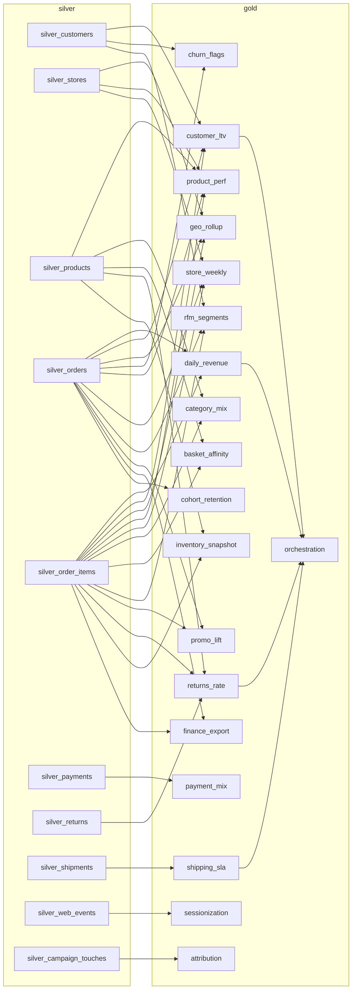

# daiwt_03 estate map

Legacy estate: [daiwt-03-redshift](https://github.com/Cognition-Partner-Workshops-mirror/daiwt-03-redshift) (Redshift Serverless `daiwt_03_retail`, schemas `core` + `mart`). Machine-readable plan: [units.yml](units.yml). Goldens: `/Volumes/daiwt_03_mig_prod/landing/golden/` (drop `D0`, anchor `2025-12-31`).

**29 units**: 10 silver, 19 gold; 48 golden outputs.

## Dependency graph

Build order: silver (10, independent) -> gold marts (18, depend only on silver) -> `orchestration` (reads gold `daily_revenue`, `customer_ltv`, `returns_rate`, `shipping_sla`).

## Legacy job -> unit -> targets -> goldens

| Legacy job | Legacy sources | Unit | Layer | Target tables | Golden files | Upstream |
|---|---|---|---|---|---|---|
| foundation (load_core) | `legacy/redshift/00_foundation/02_core_tables.sql` `legacy/redshift/00_foundation/03_udfs.sql` | `silver_customers` | silver | `silver.customers` | `outputs/D0/foundation/customers.csv` | bronze |
| foundation (load_core) | `legacy/redshift/00_foundation/02_core_tables.sql` | `silver_stores` | silver | `silver.stores` | `outputs/D0/foundation/stores.csv` | bronze |
| foundation (load_core) | `legacy/redshift/00_foundation/02_core_tables.sql` | `silver_products` | silver | `silver.products` | `outputs/D0/foundation/products.csv` | bronze |
| foundation (load_core) | `legacy/redshift/00_foundation/02_core_tables.sql` | `silver_orders` | silver | `silver.orders` | `outputs/D0/foundation/orders.csv` | bronze |
| foundation (load_core) | `legacy/redshift/00_foundation/02_core_tables.sql` | `silver_order_items` | silver | `silver.order_items` | `outputs/D0/foundation/order_items.csv` | bronze |
| foundation (load_core) | `legacy/redshift/00_foundation/02_core_tables.sql` | `silver_payments` | silver | `silver.payments` | `outputs/D0/foundation/payments.csv` | bronze |
| foundation (load_core) | `legacy/redshift/00_foundation/02_core_tables.sql` | `silver_returns` | silver | `silver.returns` | `outputs/D0/foundation/returns.csv` | bronze |
| foundation (load_core) | `legacy/redshift/00_foundation/02_core_tables.sql` | `silver_shipments` | silver | `silver.shipments` | `outputs/D0/foundation/shipments.csv` | bronze |
| foundation (load_core) | `legacy/redshift/00_foundation/02_core_tables.sql` | `silver_web_events` | silver | `silver.web_events` | `outputs/D0/foundation/web_events.csv` | bronze |
| foundation (load_core) | `legacy/redshift/00_foundation/02_core_tables.sql` | `silver_campaign_touches` | silver | `silver.campaign_touches` | `outputs/D0/foundation/campaign_touches.csv` | bronze |
| daily_revenue | `legacy/redshift/units/daily_revenue/etl.sql` `legacy/redshift/units/daily_revenue/report.sql` | `daily_revenue` | gold | `gold.daily_revenue` `gold.report_daily_revenue` | `outputs/D0/daily_revenue/daily_revenue.csv` `outputs/D0/daily_revenue/report.csv` | `silver_order_items`, `silver_orders` |
| customer_ltv | `legacy/redshift/units/customer_ltv/etl.sql` `legacy/redshift/units/customer_ltv/report.sql` | `customer_ltv` | gold | `gold.customer_ltv` `gold.report_customer_ltv` | `outputs/D0/customer_ltv/customer_ltv.csv` `outputs/D0/customer_ltv/report.csv` | `silver_customers`, `silver_order_items`, `silver_orders` |
| geo_rollup | `legacy/redshift/units/geo_rollup/etl.sql` `legacy/redshift/units/geo_rollup/report.sql` | `geo_rollup` | gold | `gold.geo_rollup` `gold.report_geo_rollup` | `outputs/D0/geo_rollup/geo_rollup.csv` `outputs/D0/geo_rollup/report.csv` | `silver_order_items`, `silver_orders`, `silver_stores` |
| churn_flags | `legacy/redshift/units/churn_flags/etl.sql` `legacy/redshift/units/churn_flags/report.sql` | `churn_flags` | gold | `gold.churn_flags` `gold.report_churn_flags` | `outputs/D0/churn_flags/churn_flags.csv` `outputs/D0/churn_flags/report.csv` | `silver_customers`, `silver_orders` |
| product_perf | `legacy/redshift/units/product_perf/etl.sql` `legacy/redshift/units/product_perf/report.sql` | `product_perf` | gold | `gold.product_perf` `gold.report_product_perf` | `outputs/D0/product_perf/product_perf.csv` `outputs/D0/product_perf/report.csv` | `silver_order_items`, `silver_orders`, `silver_products`, `silver_stores` |
| store_weekly | `legacy/redshift/units/store_weekly/etl.sql` `legacy/redshift/units/store_weekly/report.sql` | `store_weekly` | gold | `gold.store_weekly` `gold.report_store_weekly` | `outputs/D0/store_weekly/store_weekly.csv` `outputs/D0/store_weekly/report.csv` | `silver_order_items`, `silver_orders`, `silver_stores` |
| category_mix | `legacy/redshift/units/category_mix/etl.sql` `legacy/redshift/units/category_mix/report.sql` | `category_mix` | gold | `gold.category_mix` `gold.report_category_mix` | `outputs/D0/category_mix/category_mix.csv` `outputs/D0/category_mix/report.csv` | `silver_order_items`, `silver_products` |
| basket_affinity | `legacy/redshift/units/basket_affinity/etl.sql` `legacy/redshift/units/basket_affinity/report.sql` | `basket_affinity` | gold | `gold.basket_affinity` `gold.report_basket_affinity` | `outputs/D0/basket_affinity/basket_affinity.csv` `outputs/D0/basket_affinity/report.csv` | `silver_order_items`, `silver_products` |
| sessionization | `legacy/redshift/units/sessionization/etl.sql` `legacy/redshift/units/sessionization/report.sql` | `sessionization` | gold | `gold.web_sessions` `gold.report_sessionization` | `outputs/D0/sessionization/web_sessions.csv` `outputs/D0/sessionization/report.csv` | `silver_web_events` |
| shipping_sla | `legacy/redshift/units/shipping_sla/etl.sql` `legacy/redshift/units/shipping_sla/report.sql` | `shipping_sla` | gold | `gold.shipping_sla` `gold.report_shipping_sla` | `outputs/D0/shipping_sla/shipping_sla.csv` `outputs/D0/shipping_sla/report.csv` | `silver_shipments` |
| rfm_segments | `legacy/redshift/units/rfm_segments/etl.sql` `legacy/redshift/units/rfm_segments/report.sql` | `rfm_segments` | gold | `gold.rfm_segments` `gold.report_rfm_segments` | `outputs/D0/rfm_segments/rfm_segments.csv` `outputs/D0/rfm_segments/report.csv` | `silver_customers`, `silver_order_items`, `silver_orders` |
| promo_lift | `legacy/redshift/units/promo_lift/etl.sql` `legacy/redshift/units/promo_lift/report.sql` | `promo_lift` | gold | `gold.promo_lift` `gold.report_promo_lift` | `outputs/D0/promo_lift/promo_lift.csv` `outputs/D0/promo_lift/report.csv` | `silver_order_items`, `silver_orders` |
| payment_mix | `legacy/redshift/units/payment_mix/etl.sql` `legacy/redshift/units/payment_mix/report.sql` | `payment_mix` | gold | `gold.payment_mix` `gold.report_payment_mix` | `outputs/D0/payment_mix/payment_mix.csv` `outputs/D0/payment_mix/report.csv` | `silver_payments` |
| returns_rate | `legacy/redshift/units/returns_rate/etl.sql` `legacy/redshift/units/returns_rate/report.sql` | `returns_rate` | gold | `gold.returns_rate` `gold.report_returns_rate` | `outputs/D0/returns_rate/returns_rate.csv` `outputs/D0/returns_rate/report.csv` | `silver_order_items`, `silver_products`, `silver_returns` |
| attribution | `legacy/redshift/units/attribution/etl.sql` `legacy/redshift/units/attribution/report.sql` | `attribution` | gold | `gold.attribution` `gold.report_attribution` | `outputs/D0/attribution/attribution.csv` `outputs/D0/attribution/report.csv` | `silver_campaign_touches` |
| inventory_snapshot | `legacy/redshift/units/inventory_snapshot/etl.sql` `legacy/redshift/units/inventory_snapshot/report.sql` | `inventory_snapshot` | gold | `gold.inventory_snapshot` `gold.report_inventory_snapshot` | `outputs/D0/inventory_snapshot/inventory_snapshot.csv` `outputs/D0/inventory_snapshot/report.csv` | `silver_order_items`, `silver_products` |
| finance_export | `legacy/redshift/units/finance_export/etl.sql` `legacy/redshift/units/finance_export/report.sql` | `finance_export` | gold | `gold.finance_monthly` `gold.report_finance_export` | `outputs/D0/finance_export/finance_monthly.csv` `outputs/D0/finance_export/report.csv` | `silver_order_items`, `silver_orders` |
| cohort_retention | `legacy/redshift/units/cohort_retention/etl.sql` `legacy/redshift/units/cohort_retention/report.sql` | `cohort_retention` | gold | `gold.cohort_retention` `gold.report_cohort_retention` | `outputs/D0/cohort_retention/cohort_retention.csv` `outputs/D0/cohort_retention/report.csv` | `silver_orders` |
| orchestration | `legacy/redshift/99_orchestration/exec_summary/etl.sql` `legacy/redshift/99_orchestration/exec_summary/report.sql` | `orchestration` | gold | `gold.exec_summary` `gold.report_orchestration` | `outputs/D0/orchestration/exec_summary.csv` `outputs/D0/orchestration/report.csv` | `customer_ltv`, `daily_revenue`, `returns_rate`, `shipping_sla` |

## Out of scope (no golden output)

- `legacy/redshift/units/finance_export/export.sql`: UNLOAD to placeholder S3/IAM, not run by the legacy build.
- `legacy/redshift/99_orchestration/refresh_schedule.yaml`: scheduler spec, not installed; maps to the Databricks job DAG, not a unit.
- `legacy/redshift/00_foundation/01_schemas.sql`: creates source schemas only.
