# DAIWT-03 estate map

## Scope and evidence

Read-only discovery of the Amazon Redshift retail estate, anchored at `2025-12-31`.
`estate.yml` selects Redshift and D0 only. The remote golden manifest at
`/Volumes/daiwt_03_mig_prod/landing/golden/manifest.json` was read after checking
Databricks identity and matches `golden/manifest.json`: 58 files (10 inputs,
48 outputs), 20 units: one Silver foundation table group and 19 Gold jobs.
No setup, reset, capture, deployment, or source writes were performed.

`docs/units.yml` is the builder plan: each output has one owner, manifest keys,
and a golden path relative to the golden root. Reports with no manifest table
are explicitly assigned `gold.report_<unit>`; those names are target design,
not claimed source tables. Foundation retains the existing captured table-group
boundary, allowing `fetch-goldens --units foundation` to select its ten outputs.
`reads` gives table-level inputs; `depends_on` gives data dependencies.
Legacy source paths are relative to `daiwt-03-redshift`.

## Dependency graph

```mermaid
flowchart TD
  inputs["D0 core inputs / framework Bronze landing"] --> foundation["foundation · Silver (10 tables)"]
  foundation --> daily_revenue["daily_revenue · Gold"]
  foundation --> customer_ltv["customer_ltv · Gold"]
  foundation --> geo_rollup["geo_rollup · Gold"]
  foundation --> churn_flags["churn_flags · Gold"]
  foundation --> product_perf["product_perf · Gold"]
  foundation --> store_weekly["store_weekly · Gold"]
  foundation --> category_mix["category_mix · Gold"]
  foundation --> basket_affinity["basket_affinity · Gold"]
  foundation --> sessionization["sessionization · Gold"]
  foundation --> shipping_sla["shipping_sla · Gold"]
  foundation --> rfm_segments["rfm_segments · Gold"]
  foundation --> promo_lift["promo_lift · Gold"]
  foundation --> payment_mix["payment_mix · Gold"]
  foundation --> returns_rate["returns_rate · Gold"]
  foundation --> attribution["attribution · Gold"]
  foundation --> inventory_snapshot["inventory_snapshot · Gold"]
  foundation --> finance_export["finance_export · Gold"]
  foundation --> cohort_retention["cohort_retention · Gold"]
  daily_revenue --> orchestration["orchestration · Gold"]
  customer_ltv --> orchestration["orchestration · Gold"]
  returns_rate --> orchestration["orchestration · Gold"]
  shipping_sla --> orchestration["orchestration · Gold"]
```

Build foundation first. The eighteen independent Gold analytics jobs may then
run in parallel. Run orchestration last, after its four data dependencies.
The vendored two-wave builder launches all Gold builders together; integration
must infer the four summary edges from SQL. Builders should implement summary
references from this plan rather than require upstream Gold SQL to be merged
while authoring. Runtime dependency order is distinct from authoring order.

## Legacy job → unit → target → golden

| Legacy job / scripts | Unit (layer) | Target tables | Golden files (relative to golden root) |
| --- | --- | --- | --- |
| `legacy/redshift/00_foundation/01_schemas.sql` `legacy/redshift/00_foundation/02_core_tables.sql` `legacy/redshift/00_foundation/03_udfs.sql` | foundation (silver) | `silver.customers` `silver.stores` `silver.products` `silver.orders` `silver.order_items` `silver.payments` `silver.returns` `silver.shipments` `silver.web_events` `silver.campaign_touches` | `outputs/D0/foundation/customers.csv` `outputs/D0/foundation/stores.csv` `outputs/D0/foundation/products.csv` `outputs/D0/foundation/orders.csv` `outputs/D0/foundation/order_items.csv` `outputs/D0/foundation/payments.csv` `outputs/D0/foundation/returns.csv` `outputs/D0/foundation/shipments.csv` `outputs/D0/foundation/web_events.csv` `outputs/D0/foundation/campaign_touches.csv` |
| `legacy/redshift/units/daily_revenue/etl.sql` `legacy/redshift/units/daily_revenue/report.sql` | daily_revenue (gold) | `gold.daily_revenue` `gold.report_daily_revenue` | `outputs/D0/daily_revenue/daily_revenue.csv` `outputs/D0/daily_revenue/report.csv` |
| `legacy/redshift/units/customer_ltv/etl.sql` `legacy/redshift/units/customer_ltv/report.sql` | customer_ltv (gold) | `gold.customer_ltv` `gold.report_customer_ltv` | `outputs/D0/customer_ltv/customer_ltv.csv` `outputs/D0/customer_ltv/report.csv` |
| `legacy/redshift/units/geo_rollup/etl.sql` `legacy/redshift/units/geo_rollup/report.sql` | geo_rollup (gold) | `gold.geo_rollup` `gold.report_geo_rollup` | `outputs/D0/geo_rollup/geo_rollup.csv` `outputs/D0/geo_rollup/report.csv` |
| `legacy/redshift/units/churn_flags/etl.sql` `legacy/redshift/units/churn_flags/report.sql` | churn_flags (gold) | `gold.churn_flags` `gold.report_churn_flags` | `outputs/D0/churn_flags/churn_flags.csv` `outputs/D0/churn_flags/report.csv` |
| `legacy/redshift/units/product_perf/etl.sql` `legacy/redshift/units/product_perf/report.sql` | product_perf (gold) | `gold.product_perf` `gold.report_product_perf` | `outputs/D0/product_perf/product_perf.csv` `outputs/D0/product_perf/report.csv` |
| `legacy/redshift/units/store_weekly/etl.sql` `legacy/redshift/units/store_weekly/report.sql` | store_weekly (gold) | `gold.store_weekly` `gold.report_store_weekly` | `outputs/D0/store_weekly/store_weekly.csv` `outputs/D0/store_weekly/report.csv` |
| `legacy/redshift/units/category_mix/etl.sql` `legacy/redshift/units/category_mix/report.sql` | category_mix (gold) | `gold.category_mix` `gold.report_category_mix` | `outputs/D0/category_mix/category_mix.csv` `outputs/D0/category_mix/report.csv` |
| `legacy/redshift/units/basket_affinity/etl.sql` `legacy/redshift/units/basket_affinity/report.sql` | basket_affinity (gold) | `gold.basket_affinity` `gold.report_basket_affinity` | `outputs/D0/basket_affinity/basket_affinity.csv` `outputs/D0/basket_affinity/report.csv` |
| `legacy/redshift/units/sessionization/etl.sql` `legacy/redshift/units/sessionization/report.sql` | sessionization (gold) | `gold.web_sessions` `gold.report_sessionization` | `outputs/D0/sessionization/web_sessions.csv` `outputs/D0/sessionization/report.csv` |
| `legacy/redshift/units/shipping_sla/etl.sql` `legacy/redshift/units/shipping_sla/report.sql` | shipping_sla (gold) | `gold.shipping_sla` `gold.report_shipping_sla` | `outputs/D0/shipping_sla/shipping_sla.csv` `outputs/D0/shipping_sla/report.csv` |
| `legacy/redshift/units/rfm_segments/etl.sql` `legacy/redshift/units/rfm_segments/report.sql` | rfm_segments (gold) | `gold.rfm_segments` `gold.report_rfm_segments` | `outputs/D0/rfm_segments/rfm_segments.csv` `outputs/D0/rfm_segments/report.csv` |
| `legacy/redshift/units/promo_lift/etl.sql` `legacy/redshift/units/promo_lift/report.sql` | promo_lift (gold) | `gold.promo_lift` `gold.report_promo_lift` | `outputs/D0/promo_lift/promo_lift.csv` `outputs/D0/promo_lift/report.csv` |
| `legacy/redshift/units/payment_mix/etl.sql` `legacy/redshift/units/payment_mix/report.sql` | payment_mix (gold) | `gold.payment_mix` `gold.report_payment_mix` | `outputs/D0/payment_mix/payment_mix.csv` `outputs/D0/payment_mix/report.csv` |
| `legacy/redshift/units/returns_rate/etl.sql` `legacy/redshift/units/returns_rate/report.sql` | returns_rate (gold) | `gold.returns_rate` `gold.report_returns_rate` | `outputs/D0/returns_rate/returns_rate.csv` `outputs/D0/returns_rate/report.csv` |
| `legacy/redshift/units/attribution/etl.sql` `legacy/redshift/units/attribution/report.sql` | attribution (gold) | `gold.attribution` `gold.report_attribution` | `outputs/D0/attribution/attribution.csv` `outputs/D0/attribution/report.csv` |
| `legacy/redshift/units/inventory_snapshot/etl.sql` `legacy/redshift/units/inventory_snapshot/report.sql` | inventory_snapshot (gold) | `gold.inventory_snapshot` `gold.report_inventory_snapshot` | `outputs/D0/inventory_snapshot/inventory_snapshot.csv` `outputs/D0/inventory_snapshot/report.csv` |
| `legacy/redshift/units/finance_export/etl.sql` `legacy/redshift/units/finance_export/report.sql` | finance_export (gold) | `gold.finance_monthly` `gold.report_finance_export` | `outputs/D0/finance_export/finance_monthly.csv` `outputs/D0/finance_export/report.csv` |
| `legacy/redshift/units/cohort_retention/etl.sql` `legacy/redshift/units/cohort_retention/report.sql` | cohort_retention (gold) | `gold.cohort_retention` `gold.report_cohort_retention` | `outputs/D0/cohort_retention/cohort_retention.csv` `outputs/D0/cohort_retention/report.csv` |
| `legacy/redshift/99_orchestration/exec_summary/etl.sql` `legacy/redshift/99_orchestration/exec_summary/report.sql` | orchestration (gold) | `gold.exec_summary` `gold.report_orchestration` | `outputs/D0/orchestration/exec_summary.csv` `outputs/D0/orchestration/report.csv` |

## Translation and execution boundaries

Per-unit dialect notes in `units.yml` cover decimal scales and rounding,
integer division, boundary-counting date differences, NULL/empty-string
semantics, padded CHAR values, and UTC/NTZ timestamp rendering. Preserve the
captured results rather than normalize them. Match report projections as well
as mart outputs; honor ORDER BY before LIMIT. Physical Redshift distribution,
sort and encoding clauses are not semantic Delta requirements. Inline the two
shared UDF expressions within their consumers to avoid shared mutable code.
Historical `docs/discovery/` is reference material, not an executable registry;
its old registry paths and schema provisioning instructions are not current.

## Out of scope (no golden output)

- `legacy/redshift/units/finance_export/export.sql`: placeholder S3 UNLOAD,
  skipped during capture; no export file in the manifest. Monthly mart and its
  report remain in scope.
- `legacy/redshift/99_orchestration/refresh_schedule.yaml`: uninstalled schedule
  specification, skipped during capture; no schedule output in the manifest.
  The executive summary ETL and report remain in scope. The historical nightly
  schedule is context, not permission to deploy or invoke it.
- Source schema creation, source setup/reset and capture tooling are not target
  output units. Foundation DDL/UDF files are read as translation references,
  not executed against Redshift. Seed, legacy, golden and validation assets
  remain unchanged.
